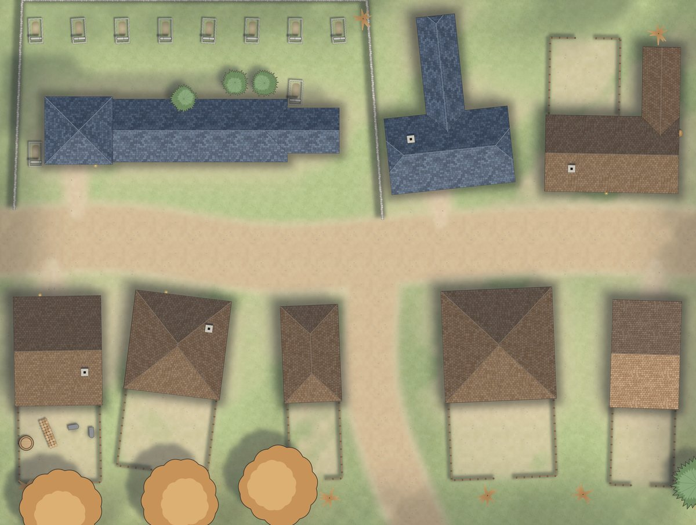
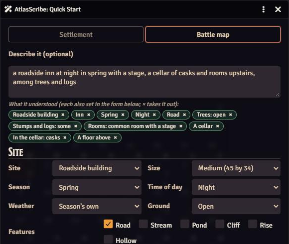
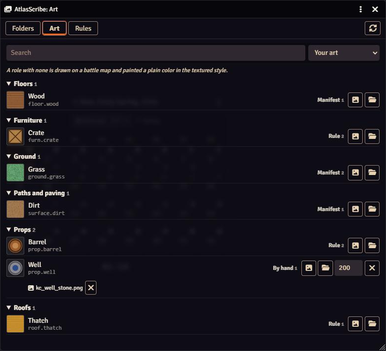

# AtlasScribe: Map Generator

Maps for Foundry VTT, made in the game: villages, towns and walled cities, regions with their roads and places, and battle maps to fight on, caves and dungeons among them.

You say what matters (the roads, the river, the square, the walls, what each district is like, an inn with a stage and a cellar of casks) and AtlasScribe fills in the rest: side streets, plots, houses, gardens, trees, rooms and furniture. Change anything on the map, reroll a district you don't like, lock the ones you do, and make it a scene. It needs no art: town maps are drawn in an illustrated style, and battle maps paint with the map art you have and draw whatever you don't.

It's system agnostic and for the GM. On battle maps it also follows the rules of Pathfinder Second Edition and D&D Fifth Edition.

## What it looks like

A town from Quick Start, drawn with no art:


A walled city with its wards, river and suburbs:


A battle map made with no art at all, with its roofs on, as players see it from outside, and off, as a token inside sees it:


The same thing in the inked look, a village street in autumn:



Quick Start, for a town or a battle map, from a few choices or a few words:

 

## Install

In Foundry's Setup screen: Add-on Modules, Install Module, and paste this manifest URL:

```
https://github.com/Sir-Bayard/atlas-scribe/releases/latest/download/module.json
```

Enable AtlasScribe in your world. It needs Foundry 14 and works with any game system. No other module is needed. Its window and notes are in English only.

## Your first town

1. As the GM, open the Scenes tab and click **AtlasScribe**.
2. Click **Quick Start** (the magic wand). Pick a Place (a hamlet up to a metropolis), a season, the water and roads, or type what you want in the Describe box: "a walled market town called 'Kestrel's Rest' on a river, with a temple and an inn, in autumn". What it understood is set in the form, where you can change it. Set a choice to Any (last in its list) and the seed picks.
3. **Make the plan.** The map appears in the window in a second or two (a city takes a few seconds, a metropolis about 20). Click a district to reroll it, lock it or change its settings; drag its corners to reshape it; Draw adds roads, rivers, woods, walls, buildings and labels. Drawing and reshaping need a mouse; everything else works from the keyboard.
4. **Make scene.** AtlasScribe draws the map and makes it a scene, with hidden labels for the GM on the notable buildings. The scene takes its name from the plan's name, or from the place named in Quick Start. It's in the Scenes tab; the eye button beside Update scene goes to it.

## Your first battle map

1. In Quick Start, open the **Battle map** tab.
2. Pick a Site (Wilderness, Roadside building, Village or town street, Camp, Castle, Cave or Dungeon), the season, the time of day and what's scattered about, or describe it: "a roadside inn at night in spring with a stage, a cellar of casks and rooms upstairs".
3. **Make the plan**, look it over in the window, then **Make scene**.
4. The scene has walls, doors and windows, rooms with furniture you can move, wagons and tents you can move too, horses and oxen as tokens, roofs that fade as a token walks in, floors above and cellars as levels, lights and regions for height and water, and a moonlit night when it's set at night.

On a battle map you can also sink a road between its banks, draw your own lights, regions for difficult terrain, hazards, cover and notes, and trails of prints and picket lines. `api.snapshot` takes a picture of a scene without opening it, for comparing maps.

You can also drag a box on a town map with the **Battle map** tool, then click **Make battle map**: that corner of town opens in the window as a battle map, its streets and notable buildings where they were, ready for Make scene.

## Region maps and imports

- **A region:** Quick Start's **Region** tab makes a map miles across, with towns, villages, castles and the roads between them, woods, hills and mountains. Pick a place on it and click **Make its map** to start that place's own plan.
- **Other tools' maps:** **Import** opens a Watabou city or village (its JSON) as a starting plan, or a Universal VTT file (.dd2vtt, .uvtt, .df2vtt) with its walls and image. A scene's menu in the sidebar has **Export as Universal VTT**.
- **Examples:** [a village](examples/village-edrics-cross.json), [a city](examples/city-kestrelmouth.json) and [an inn](examples/inn-lantern-and-oar.json) to download and open with **Import**.

## Art

AtlasScribe ships no art and needs none.

- **Town and city maps** are drawn in the illustrated style: ink lines, one light palette, streets by their paving, fields by their crop. Nothing to set up.
- **Battle maps** paint with your map art where you have it and draw the rest. With no art at all, the whole map is drawn, in one of two looks (Configure Settings, AtlasScribe, Drawn battle art): Painted or Inked.
- **Your own art:** Configure Settings, AtlasScribe, **Art** opens the Art window. List folders of map art on your server on its Folders tab (then **Save and read**); Forgotten Adventures files are found by their names, and any other pack can say which image is which with a small manifest or with filename rules. You can also choose an image for any kind of art by hand. If you use FA Nexus, AtlasScribe fetches the Forgotten Adventures art you have through it: it uses your FA Nexus Patreon connection, downloads into FA Nexus's own folder, and may open and close FA Nexus's window during a render. Configure Settings turns that off.



A map painted from someone's art is for your own table under that art's license.

## Game rules

- **Any system:** Foundry's own region rules. Banks and shallow water slow walkers, and stairs change level.
- **With Battle map heights on (the default):** deep water is swum, a token's elevation follows the ground, and a walker can't step off a cliff.
- **Pathfinder Second Edition:** scenes and regions get their environment (urban, forest, plains), a walker stopped at a cliff gets an Athletics check at its Climb DC, and with PF2E Visioner fences and low walls give cover.
- **D&D Fifth Edition:** banks, slopes, shallows and ice are its own kinds of difficult terrain, the ground is laid as floors for its falling, and a walker stopped at a cliff gets an Athletics check.

## What it saves

Maps, thumbnails and backups go into the folders set in Configure Settings (by default an `atlas-scribe` folder inside your world's folder). They build up as you remake scenes; the window's **Files** button shows each plan's files and which one its scene uses, and Foundry's file browser can delete the rest. Anyone logged in can fetch a file under Data if they know its path, so don't keep secrets in a map's name.

AtlasScribe won't change a scene it didn't make unless a script publishes with `force: true`. That replaces the scene's grid, padding, fog, vision and environment as well as its picture (it's backed up first).

## Learn more

The [guide](docs/guide.md) covers everything: the window and every tool, cities and their wards, battle maps, regions, art folders and manifests, and the API for scripts. A script should pass its own `seed` or `id`: otherwise every unnamed village gets the same id, and making a second one updates the first one's scene.

## Changes

See [CHANGELOG.md](CHANGELOG.md).

## How it was made

Written with Claude and tested in Foundry 14.

## Problems and suggestions

[Open an issue](https://github.com/Sir-Bayard/atlas-scribe/issues).

## License

MIT. See [LICENSE](LICENSE). AtlasScribe isn't affiliated with Forgotten Adventures; FA Nexus is named only to say what AtlasScribe works with.

## Pathfinder

AtlasScribe is an unofficial, free module for Foundry VTT. It is not published, endorsed or specifically approved by Paizo Inc. Pathfinder is a trademark of Paizo Inc., used here only to say which game its battle map rules work with. The module follows the game's rules, which Paizo publishes under the ORC License, and refers to them by name; it doesn't reproduce Paizo's rules text, art or setting material. D&D Fifth Edition (Dungeons & Dragons is a trademark of Wizards of the Coast) is named only to say which game its battle map rules also work with; the module isn't affiliated with or endorsed by Wizards of the Coast.
