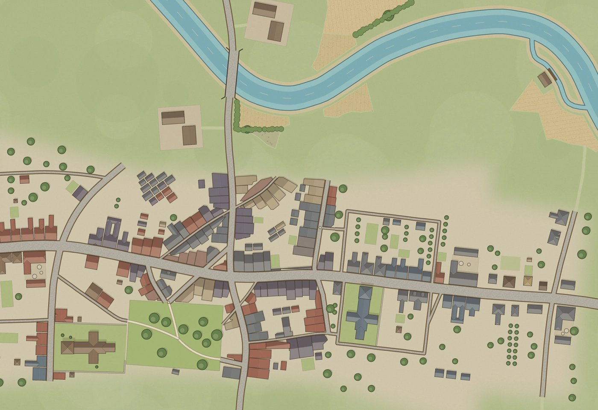
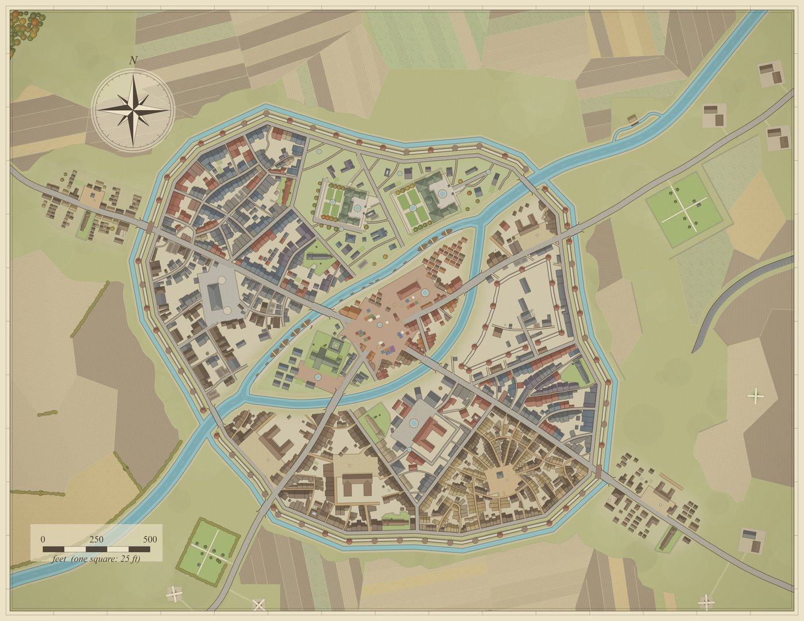
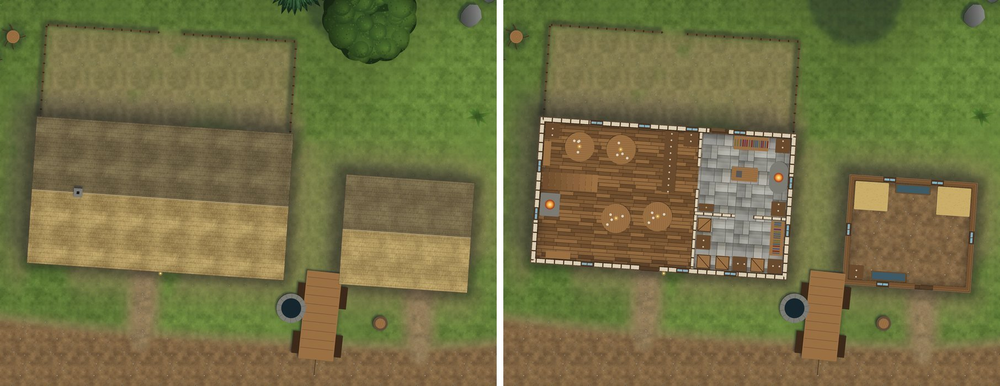
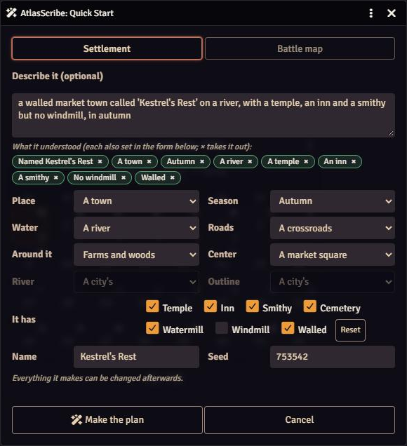

# AtlasScribe: Map Generator

Maps for Foundry VTT, made in the game: villages, towns and walled cities, and battle maps to fight on.

You say what matters (the roads, the river, the square, the walls, what each district is like, an inn with a stage and a cellar of casks) and AtlasScribe fills in the rest: side streets, plots, houses, gardens, trees, rooms and furniture. Change anything on the map, reroll a district you don't like, lock the ones you do, and make it a scene. It needs no art: town maps are drawn in an illustrated style, and battle maps paint with the map art you have and draw whatever you don't.

It's system agnostic and for the GM. On battle maps it also follows the rules of Pathfinder Second Edition.

**Status: release candidate (0.9).** Everything below works; 1.0.0 follows once it has been tried by someone who didn't build it. [Tell me what goes wrong](https://github.com/Sir-Bayard/atlas-scribe/issues).

## What it looks like

A town from Quick Start, drawn with no art:



A walled city with its wards, river and suburbs:



A battle map made with no art at all, with its roofs on, as players see it from outside, and off, as a token inside sees it:



The same thing in the inked look, a village street in autumn:


Quick Start, for a town or a battle map, from a few choices or a few words:

 

## Install

In Foundry's Setup screen: Add-on Modules, Install Module, and paste this manifest URL:

```
https://github.com/Sir-Bayard/atlas-scribe/releases/latest/download/module.json
```

Enable AtlasScribe in your world. It needs Foundry 14 and works with any game system. No other module is needed.

## Your first town

1. As the GM, open the Scenes tab and click **AtlasScribe**.
2. Click **Quick Start** (the magic wand). Pick a Place (a hamlet up to a metropolis), a season, the water and roads, or type what you want in the Describe box: "a walled market town called 'Kestrel's Rest' on a river, with a temple and an inn, in autumn". What it understood is set in the form, where you can change it. Set a choice to Any (last in its list) and the seed picks.
3. **Make the plan.** The map appears in the window in a second or two (a city takes a few seconds, a metropolis about 20). Click a district to reroll it, lock it or change its settings; drag its corners to reshape it; Draw adds roads, rivers, woods, walls, buildings and labels.
4. **Make scene.** AtlasScribe draws the map and makes it a scene, with hidden labels for the GM on the notable buildings. The scene is in the Scenes tab; the eye button beside Update scene goes to it.

## Your first battle map

1. In Quick Start, open the **Battle map** tab.
2. Pick a Site (Wilderness, Roadside building, Village or town street, Camp or Castle), the season, the time of day and what's scattered about, or describe it: "a roadside inn at night in spring with a stage, a cellar of casks and rooms upstairs".
3. **Make the plan**, look it over in the window, then **Make scene**.
4. The scene has walls, doors and windows, rooms with furniture you can move, roofs that fade as a token walks in, floors above and cellars as levels, lights and regions for height and water.

You can also drag a box on a town map with the **Battle map** tool, then click **Make battle map**: that corner of town opens in the window as a battle map, its streets and notable buildings where they were, ready for Make scene.

## Art

AtlasScribe ships no art and needs none.

- **Town and city maps** are drawn in the illustrated style: ink lines, one light palette, streets by their paving, fields by their crop. Nothing to set up.
- **Battle maps** paint with your map art where you have it and draw the rest. With no art at all, the whole map is drawn, in one of two looks (Configure Settings, AtlasScribe, Drawn battle art): Painted or Inked.
- **Your own art:** Configure Settings, AtlasScribe, **Art** opens the Art window. List folders of map art on your server on its Folders tab (then **Save and read**); Forgotten Adventures files are found by their names, and any other pack can say which image is which with a small manifest or with filename rules. You can also choose an image for any kind of art by hand. If you use FA Nexus, AtlasScribe fetches the Forgotten Adventures art you have through it.


A map painted from someone's art is for your own table under that art's license.

## Game rules

Battle maps work in any system with Foundry's own region rules: banks and shallow water slow walkers and stairs change level. With the Battle map heights setting (on by default), deep water is swum, a token's elevation follows the ground and a walker can't step off a cliff. In Pathfinder Second Edition, scenes and regions also get their environment (urban, forest, plains), a walker stopped at a cliff gets an Athletics check at its Climb DC, and with PF2E Visioner fences and low walls give cover. Other systems may follow after 1.0.

## Learn more

The [guide](docs/guide.md) covers everything: the window and every tool, cities and their wards, battle maps, art folders and manifests, and the API for scripts.

## Changes

See [CHANGELOG.md](CHANGELOG.md).

## How it was made

Written with Claude and tested in Foundry 14.

## Problems and suggestions

[Open an issue](https://github.com/Sir-Bayard/atlas-scribe/issues).

## License

MIT. See [LICENSE](LICENSE). AtlasScribe isn't affiliated with Forgotten Adventures; FA Nexus is named only to say what AtlasScribe works with.

## Pathfinder

AtlasScribe is an unofficial, free module for Foundry VTT. It is not published, endorsed or specifically approved by Paizo Inc. Pathfinder is a trademark of Paizo Inc., used here only to say which game its battle map rules work with. The module follows the game's rules, which Paizo publishes under the ORC License, and refers to them by name; it doesn't reproduce Paizo's rules text, art or setting material.
